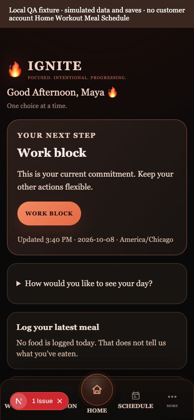
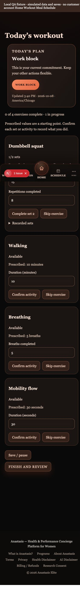
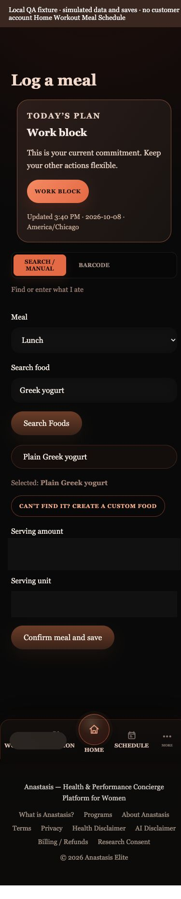
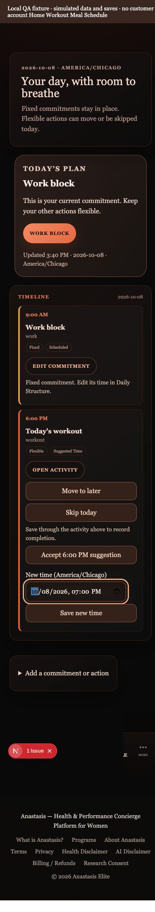

# Coordinated daily dashboard review

Branch: `codex/coordinated-daily-dashboard`

The dashboard now coordinates one daily recommendation across Home, Schedule, Nutrition, Recovery, and Workouts. The recommendation reports its user-local day, timezone, timestamp, supporting records, and data availability. Existing training and nutrition calculations remain the source of targets and adaptations.

## Experience changes

- **Today and Home:** one primary action, a short reason, up to three essentials, compact schedule and progress. Unknown food, water, and activity logs are described as missing information. Completed training requires a supporting record. Local greetings, dates, and active segments share timezone helpers. Minute/visibility refresh and mutation invalidation keep guidance current.
- **Daily Structure:** existing structured, flexible, hybrid, and one-step preferences are preserved and editable from Home and onboarding. One-step mode hides supporting essentials and collapses schedule/progress. Transition buffers preserve unscheduled space; proposed workout times require acceptance. Preference and recurring-commitment saves have explicit scopes.
- **Hydration and meals:** daily hydration goals remain separate from small editable drink actions. Retry-safe water submissions avoid duplicate additions. Search/manual, barcode, and Phoenix photo entry have independent panels and retained drafts. Camera denial, missing products, and scanner failures allow manual entry. Ember guidance-only, Ignite manual/barcode, and Phoenix manual/barcode/photo boundaries are enforced in APIs and the interface.
- **Workouts:** prescribed values are distinguished from confirmed performance. Strength uses compact sets/reps/load controls with equipment increments, unit preferences, and total/per-hand labels. Walking, breathing, and mobility use their prescribed duration or repetitions. Partial sessions, skips, pause/resume, substitutions, completion counts, and session summaries are supported. A single manual strength set no longer completes the whole workout.
- **Shared inputs:** daily check-in, recovery, and cycle use canonical daily answers and timestamp-aware symptom context. Untouched defaults are not recorded as answers. Cycle-specific details remain separate; historical records are retained.
- **Schedule:** destinations match events; health completion uses the relevant logging workflow. Personal events can complete, flexible events can move or skip, and suggestions have acceptance controls. Original time and accepted new time are separate. Recurring commitments, overnight windows, transition buffers, and rescheduled dates are considered without filling every gap.
- **Navigation and detail:** Progress and Assessments have consistent access from More and Account. Home detail is disclosed on demand. Assessment drafts and known inputs are retained; monthly completion is checked against the local month. Mobile navigation has readable labels, clear focus, comfortable targets, and content clearance.

## Data and compatibility

The additive migration `supabase/migrations/20261009004035_coordinated_daily_dashboard.sql` adds nullable `cycle_logs.answered_fields`, retry IDs on daily water logs, and owner-scoped, invoker-security functions for water additions, recurring-commitment replacement, current-day workout saves, and atomic recorded-set replacement. It preserves existing history, ownership, and RLS; it does not backfill guessed cycle answers or delete past health records. Existing logs remain readable. Apply the migration in a local/test environment before exercising the new write paths.

Existing nutrition boundary work was preserved and integrated, including `20260917_tier_specific_nutrition_logging.sql` and the additive `20261008_meal_logging_boundaries.sql`. The dedicated migration script tests the new dashboard migration against an isolated representative schema, not the entire production migration chain.

No live database migration, production deployment, billing change, or customer-health mutation was performed. Unrelated existing About-page changes and generated TypeScript state remain outside the dashboard commits.

## Checks actually run

| Check | Result |
| --- | --- |
| `npm run test` | 225 passed; 0 failed; 0 skipped |
| `npm run typecheck` | Passed after the final production build regenerated route types |
| `npm run lint` | Passed with existing repository warnings |
| `npm run build` | Passed; temporary QA route absent from production route output |
| `git diff --check` | Passed |
| Isolated PostgreSQL migration checks | Passed: additive columns, water retry idempotency, invalid-input rejection, atomic rollback, session resume, preserved history, owner RLS, and anonymous denial |
| Browser at 390 × 844 | Actual components verified using explicitly simulated local QA data; no horizontal overflow in the four revised flows |

Focused coverage includes Chicago morning/afternoon and local rollover; 23/25-hour daylight-saving days and nonexistent reschedule times; missing versus confirmed intake; consistent shared recommendations and recorded training; steady hydration without rapid catch-up; activity controls and partial completion; direct tier API denials; shared symptom history; preference preservation; and schedule ownership, destinations, completion, skip, and rescheduling.

Browser verification included camera denial and an unknown barcode followed by successful manual meal entry, retained serving/meal drafts, Phoenix's unavailable-photo-provider message, Ember guidance-only entry, workout reload/resume, schedule move/skip/accept feedback, quieter Home, meal-tab keyboard navigation, and More-menu focus restoration. Browser saves were simulated; route tests independently exercised authorization/write behavior, and PostgreSQL tests exercised the new functions.

## Remaining limits and algorithm question

- Local Supabase credentials and a named non-production account were unavailable. Actual login, connected wearable freshness, and a Stripe transaction were not exercised. Existing authentication/billing guard tests passed; this does not establish a live login/payment flow. These flows still need connected staging verification.
- Photo estimation's existing server provider is unconfigured (`501`). Phoenix receives an actionable availability message and can use manual/barcode entry. Estimates must be reviewed before saving when a provider is configured.
- `lib/cycle/getCycleTrainingAdjustment.ts` retains estimated-phase multipliers (menstrual `0.85`, pre-period `0.9`, luteal `0.95`) without considering individual symptoms. This conflicts with the product's stated symptom-first principle. No replacement clinical algorithm was invented; this decision needs product/domain review.

## Reproduce isolated browser review

The fixture is opt-in and excluded from the normal application. It uses the clearly identified `LOCAL-QA-ONLY` client, fake database reads, simulated API writes, and denied camera access. It never connects to a customer account. In local development:

```sh
node scripts/dashboard-browser-fixture.mjs --install
npm run dev
```

Open `/local-dashboard-qa?view=home&tier=ignite` at 390 × 844. Views: `home`, `workout`, `meal`, `schedule`; tiers: `ember`, `ignite`, `phoenix`; add `quiet=true` for the one-step Home. Stop the server and remove the temporary route before building:

```sh
node scripts/dashboard-browser-fixture.mjs --remove
npm run build
```

The fixture script refuses to overwrite or remove edited files. The QA page also refuses production rendering. The screenshots below were captured from this local fixture; the Next development indicator reflects missing local Supabase configuration, not a verified connected account.

To repeat the database checks, provide an installed PGlite module without changing repository dependencies:

```sh
PGLITE_MODULE=/absolute/path/to/@electric-sql/pglite/dist/index.js node scripts/verify-daily-dashboard-migration.mjs
```

## Mobile screenshots

| Home | Workout controls |
| --- | --- |
|  |  |
| Meal entry | Schedule |
|  |  |

Additional captures: [full Home](screenshots/coordinated-dashboard/dashboard-home-mobile.jpg), [one-step Home](screenshots/coordinated-dashboard/dashboard-home-quiet-mobile.jpg), and [partial workout summary](screenshots/coordinated-dashboard/dashboard-workout-mobile.jpg).
